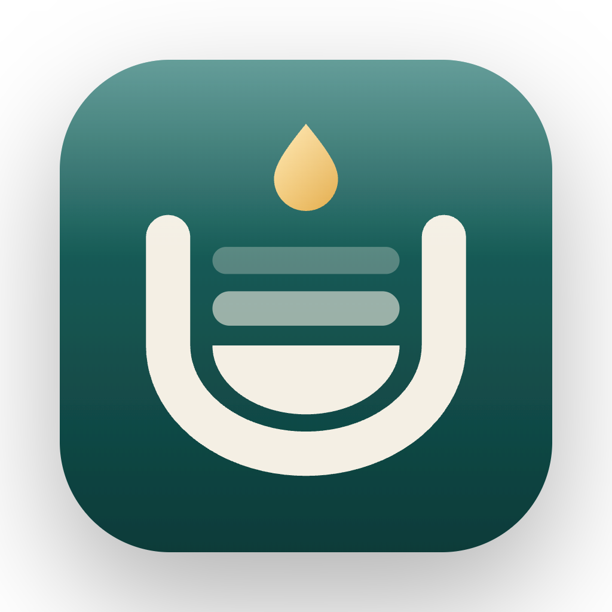

<div align="center">



# 积微 · Jiwei

**懂你的个人智能体**

它读过你的笔记、资料和录音，能替你整理、计划、写作、分析，也能按你定的规矩定期办事。<br>
每一个改动都先问你，数据都留在你的电脑上。

积微成著，日进有功 · 青风铃 出品

[下载](https://github.com/cl3582175-oss/jiwei-releases/releases/latest) ·
[更新日志](CHANGELOG.md) ·
[路线图](docs/ROADMAP.md) ·
[插件开发](docs/plugins/authoring.md) ·
[English](#english)

[](https://github.com/cl3582175-oss/jiwei-releases/releases/latest)

[](LICENSE.md)

</div>

---

## 积微是什么

通用的 AI 助手什么都懂，就是不懂你：不知道你学过什么、记过什么、在为什么事努力。积微反过来，先把你的知识攒起来，再在这些知识上替你做事。

- **它懂你**：笔记、PDF、网页、视频、课堂和会议录音、手机照片、邮件，都进同一个本地知识库。回答和产出都标明出处，点开就是原文。
- **它替你做事**：交代一句话，它会建行动项、排日程、出练习卷、写长文、做课件和讲解视频、帮你分析一个决定。它也能按你定好的规矩，每天、每周或收到新邮件时自动去做。
- **你说了算**：凡是会改动你数据的操作，都先给你看清楚再执行。读过网页或外部工具的内容之后，写入一律要你确认。花多少钱、调用过什么工具，都有记录和上限。

积微最早是一款学习笔记软件，“积微成著”是它的底色：每天一点一点的积累，最终变成看得见的成果。现在它是一个以你的知识为根基、能替你办事的智能体。

## 它能替你做什么

| 你说 | 积微做 |
| --- | --- |
| “帮我把这学期的考试排进日历” | 先问清日期、每周能投入的时间和偏好时段，再生成逐周计划给你预览，确认后才写入日历；落后时在「今日」提醒并帮你调整 |
| “每天早上 8 点看看老师的邮件，把要点放进收件箱” | 生成一个 AI 任务：触发条件、能用的工具、结果放哪儿都事先定好；邮箱只读，不会发送、删除或标记已读 |
| “根据这几份资料出一套练习卷” | 在知识库里找素材，新建一篇练习笔记，写入前先给你确认 |
| “把我对 X 的理解写成一篇文章 / 一套课件 / 一个讲解视频” | 创作工坊走完选题、素材、结构、起草、打磨、成品六步；你可以选教练、共写或代写模式；导出 Word、PDF、PPT，或在本机渲染带配音和字幕的 MP4 |
| “我该不该换这份工作？” | 参谋先在你的知识库里找依据，再给出选项、可调权重的决策矩阵、关键假设、事前验尸和反方意见；你的选择会记进决策日志，到期提醒你回顾 |
| “把刚才的会议整理一下” | 录音分清说话人，按会议纪要、只要待办、只要决策等视角整理，每条结论附原声证据，审阅后再落到笔记、行动项和复习卡片 |
| “这份卷子我错了哪些” | 拍照后自动拆成单题、裁出原图，只收做错的题，分析错因，之后用变式题帮你复习 |
| “最近这个方向有什么值得看的” | 从你订阅的 RSS、arXiv、YouTube、播客和搜索结果里，每天挑出最多 5 条，写明为什么推荐给你；还能做成一期 5 分钟左右的学习播客 |

## 它为什么懂你

- **康奈尔笔记**：线索、笔记、总结三栏；支持双向链接、公式、表格、Mermaid 图、可拖动的函数图和几何图。
- **资料库**：书籍、PDF、视频、音频、图片、网页统一管理；扫描页、表格和插图会自动识别文字。
- **内置浏览器**：一边看网页或网课一边记，带时间点笔记、字幕或本地转写，还能做外文对照阅读。
- **随手捕捉**：收件箱汇总全局快捷记录、截图识别、手机扫码上传和网页摘抄，AI 每天帮你归档。
- **录音**：课堂、会议和随想都能录，转写时区分说话人，可以回放和纠错；录音文件可以加密保存。
- **搬家**：一次导入整个 Obsidian 库、Markdown 文件夹或 Notion 导出，保留文件夹、标签、双链、图片和附件，可以整体撤销。
- **记得你**：慢慢了解你的方向、习惯和薄弱点。你可以查看和修改它记住的内容；标为“不给 AI”的笔记，任何 AI 功能都不会读取。

## 帮你真正学会

积微的初心没变：记下的东西要真的变成你自己的。

- 笔记里的线索自动变成复习卡片，按 FSRS 记忆算法在快忘的时候提醒你复习。
- 费曼练习、错题本、复盘与洞察：知识漏斗按“发现 → 阅读 → 记下 → 掌握 → 运用”统计，帮你看清在哪一步流失最多。
- 「今日」首页：晨报、今天的日程、到期复习、待办，以及 AI 任务的结果都放在一处。

## 连接与扩展

- **用其他软件的工具**：积微是 MCP 客户端，可以接入任何 MCP 服务器。会改动数据的工具默认每次询问，对外发送、删除这类操作只能每次询问或禁止。
- **当其他 AI 的长期记忆**：积微也是 MCP 服务端。Claude Desktop、Cursor、Claude Code 等可以检索你的笔记，权限按客户端分开授予，“不给 AI”的内容永远不会提供。
- **插件**：与 Claude Code 的插件和市场格式直接兼容，技能、命令、MCP 连接器都能用；任何 GitHub 仓库都可以作为插件市场。积微不运行插件里的脚本。详见[插件开发指南](docs/plugins/authoring.md)。
- **角色包**：中学生、大学生·科研、考研、求职者、产品经理、教师、内容创作者、管理者，选一个，装上对应的技能、模板和分析框架。

## 你说了算

- **写入先确认**：助手要改你的数据时，先弹出卡片写清楚要做什么；拒绝、超时或中途停止都不会执行。
- **防提示注入**：网页、邮件和外部工具返回的内容只当作数据，不当作指令；读过外部内容之后的写入一律需要确认。
- **费用透明**：显示本月、今天和每次的花费，可以分别设置单次、每天、每月上限，币种任选；DeepSeek 的低谷时段可以自动排队省钱。
- **操作可查**：“最近做了什么”记录每一次工具调用和外部访问，可以筛选和导出。
- **数据在本机**：没有积微账号，也没有积微服务器。数据每天自动备份，可以导出为单个 `.jiwei` 文件，换电脑时完整搬走。

**模型**：DeepSeek（默认）、通义千问、Kimi、智谱、OpenAI、Claude、Gemini，或任何兼容 OpenAI 接口的服务；也可以用 Ollama 在本机运行模型。API 密钥加密保存在本机。

## 下载与安装

前往 [发布页](https://github.com/cl3582175-oss/jiwei-releases/releases/latest) 下载，无需登录。

| 系统 | 安装文件 | 安装方式 |
| --- | --- | --- |
| Apple 芯片 Mac（M 系列） | `Jiwei-<版本>-mac-arm64.dmg` | 打开后拖到「应用程序」 |
| Intel Mac | `Jiwei-<版本>-mac-x64.dmg` | 打开后拖到「应用程序」 |
| Windows 64 位 | `Jiwei-<版本>-win-x64.exe` | 运行安装器，可选择安装目录 |
| Linux | `.AppImage` / `.deb` | AppImage 加执行权限即可运行；deb 用系统包管理器安装 |

积微暂未购买 Apple 和 Windows 的付费签名证书，第一次打开时系统会提示无法验证开发者，这不影响使用：

- **macOS**：双击打开，看到“Apple 无法验证”时点“完成”；然后打开 **系统设置 → 隐私与安全性**，在页面下方点 **仍要打开**。
- **Windows**：看到“Windows 已保护你的电脑”时，点 **更多信息 → 仍要运行**。

请只安装从发布页下载、且 SHA-256 与发布说明一致的文件。安装后，积微会在 设置 → 关于 里检查更新。

## 从源码运行

需要 Node.js 22.12 或更高版本。

```bash
git clone https://github.com/cl3582175-oss/jiwei.git
cd jiwei
npm install
npm run dev
```

> 国内网络可以先设置镜像：`export ELECTRON_MIRROR=https://npmmirror.com/mirrors/electron/`，并使用 `npm install --registry=https://registry.npmmirror.com`。

| 命令 | 说明 |
| --- | --- |
| `npm run dev` | 开发模式（热更新） |
| `npm run typecheck` / `npm run lint` / `npm test` | 类型检查 / 代码检查 / 单元测试 |
| `npx playwright test --config playwright.controlled.config.ts` | 端到端测试（驱动真实应用，不连接真实服务） |
| `npm run dist:mac` / `dist:win` / `dist:linux` | 打包安装程序到 `release/` |
| `npx drizzle-kit generate --name <名字>` | 修改数据库结构后生成迁移 |

**技术栈**：Electron · React 19 · TypeScript · Tailwind CSS 4 · Tiptap 3 · Yjs · SQLite（better-sqlite3 + Drizzle + FTS5 + sqlite-vec）· TanStack Query · Zustand · i18next · Playwright · electron-builder。

```
src/
├── main/        主进程：数据库、知识库、智能体（工具、权限、审计）、AI 任务、MCP、插件、录音、浏览器、导入、更新
├── worker/      后台工作进程：解析、转写、渲染等重活
├── preload/     安全桥接，由 API 契约自动生成
├── shared/      主进程与界面共用的类型、契约和校验
└── renderer/    界面（React）
resources/       数据库迁移、内置技能、官方插件市场
e2e/             端到端测试与测试素材（均为自制）
docs/            架构、文件格式、路线图、插件开发、发布流程
```

更多见 [架构说明](docs/ARCHITECTURE.md)、[数据格式](docs/FORMAT.md) 和 [发布流程](docs/release.md)。

## 许可证

[PolyForm Noncommercial 1.0.0](LICENSE.md)

- ✅ 个人、学习、研究和非营利组织使用：**免费**
- ❌ 不允许任何商业用途，包括销售、提供商业服务，或用在营利性产品中

如需商业授权，请在本仓库提交 Issue 联系。

Required Notice: Copyright (c) 2026 cl3582175-oss (https://github.com/cl3582175-oss/jiwei)

---

<a id="english"></a>

## English

**Jiwei is a personal AI agent that knows you.** It builds a local knowledge base from your notes, documents, web reading, recordings, photos and email, and then works on top of it. It can plan your schedule, run recurring AI tasks (for example, triggered by new email), draft articles, slides and narrated explainer videos, analyse decisions with evidence from your own notes, and turn meetings into minutes and action items.

Every change to your data is shown to you before it happens. Content from the web and external tools is treated as data, never as instructions. Spending limits and an activity log keep costs and actions visible. Your data stays on your computer: there is no Jiwei account or server.

Under the hood it is still a learning app at heart: Cornell notes, FSRS spaced repetition, a mistake notebook, the Feynman technique and a knowledge funnel. It speaks MCP both ways, works with Claude Code–compatible plugins, and supports DeepSeek, Qwen, Kimi, Zhipu, OpenAI, Claude, Gemini, any OpenAI-compatible API and local models via Ollama.

[Download](https://github.com/cl3582175-oss/jiwei-releases/releases/latest) for macOS (Apple silicon / Intel), Windows or Linux. The app is not yet code-signed with a paid certificate. On first launch, macOS needs **System Settings → Privacy & Security → Open Anyway**, and Windows needs **More info → Run anyway**. Free for personal and non-commercial use under [PolyForm Noncommercial 1.0.0](LICENSE.md). Made by Qingfengling (青风铃).
