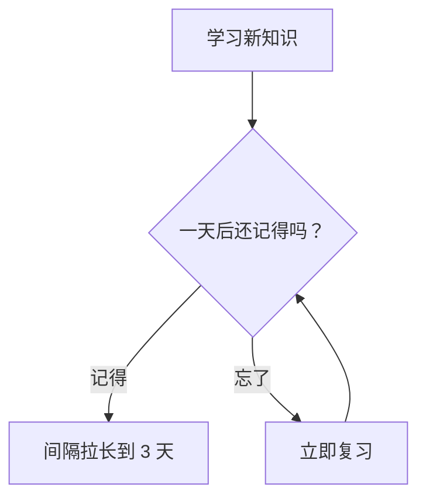

# 图示（Mermaid）

## 范围

内容来自一份较长的资料、而用户没说清是哪部分时：先用 `source_outline` 看规模与章节，再用 `ask_user` 让用户选（当前页 / 某一章 / 整份资料 / 指定页码），不要默认只用当前可见部分。范围超过约 40 段时，用 `source_read` 分几次读完再整理；只读了一部分时，在结果里注明依据的页码或章节。

## 选图

- 步骤、决策、因果链 → `flowchart TD`（自上而下）或 `flowchart LR`（自左向右）
- 多个角色之间按时间的交互 → `sequenceDiagram`
- 状态与转换 → `stateDiagram-v2`
- 实体与关系 → `erDiagram` / `classDiagram`
- 两个维度的分类（如重要 × 紧急）→ `quadrantChart`

## 写法规则（避免语法错误）

1. 节点 ID 用英文字母和数字（`A`、`step2`），**中文写在标签里**：`A[学习新知识] --> B{一天后还记得吗？}`。
2. 标签中含有括号、引号、冒号等符号时，用双引号包住：`C["复习（间隔 1 天）"]`。
3. 每行一条语句，不要在行尾加分号以外的多余符号；不要使用 `classDef`、`style`、`click`（样式由积微统一）。
4. 节点数控制在 4～20 个；一张图只讲一件事，复杂内容拆成多张。
5. 调用 `note_add_diagram`。如果返回“Mermaid 语法错误”，**根据错误信息修正后再次调用**（最多 2 次）。

## 示例

